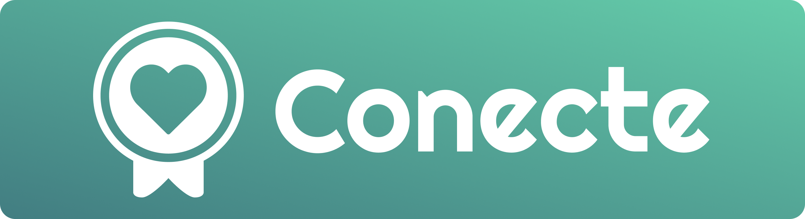
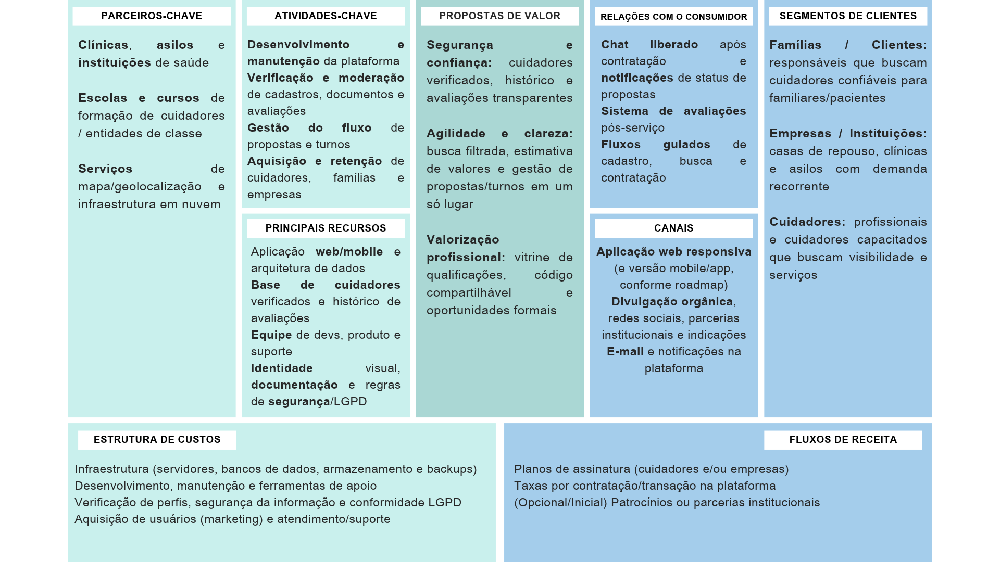
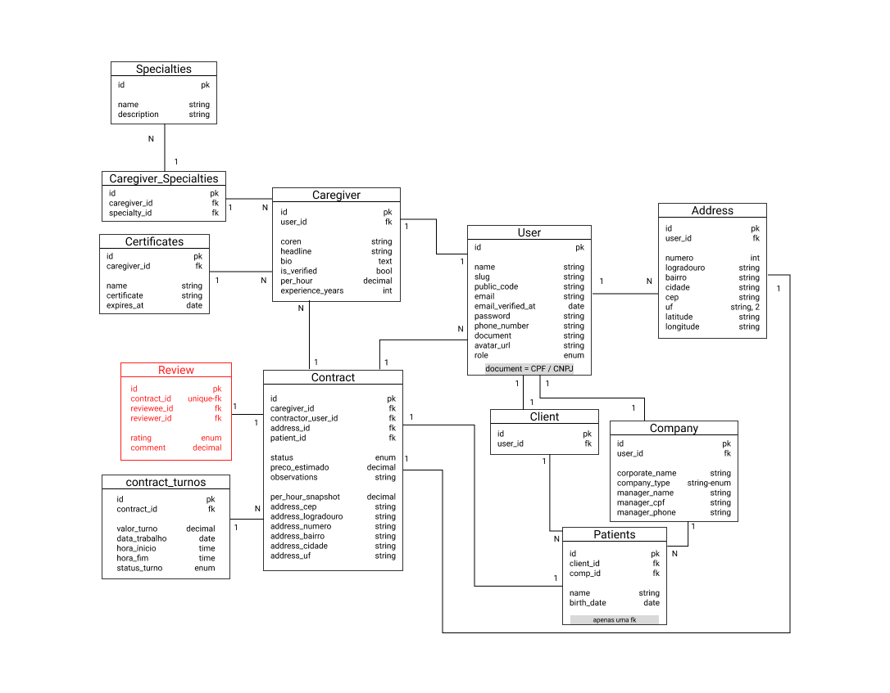

# DOCUMENTO DA APLICAÇÃO WEB

## 

Plataforma digital que conecta cuidadores de saúde a famílias e instituições que necessitam de acompanhamento e cuidados especializados.

### CENTRO PAULA SOUZA - FACULDADE DE TECNOLOGIA DE JAHU

### TECNOLOGIA EM DESENVOLVIMENTO DE SOFTWARE MULTIPLATAFORMA

**Jahu, SP**  
**Início: 1º semestre/2025**  

[Leia-me](../docs/README.md) | [Instalação](../docs/docs-01-instalacao.md) | [Configuração](../docs/docs-02-configuracao.md) | [Comandos](../docs/docs-03-comandos.md) | [Arquitetura](../docs/docs-04-arquitetura.md)

**Autores:**  

- Vinicius Leonardo Silveira - [Github](https://github.com/vinisilveiraa) / [Linkedin](https://www.linkedin.com/in/vinisilveiraa/)
- Matheus Augusto Paschuinio - [Github](https://github.com/matheuspaschuinio) / [Linkedin](https://www.linkedin.com/in/matheus-paschuinio-7630aa336/)
- Pedro Paulo Gonçalves - [Github](https://github.com/Pedrinho012-1) / [Linkedin](https://www.linkedin.com/in/pedro-paulo-00114a256/)

---

# 0. SUMÁRIO  

1. [RESUMO DA APLICAÇÃO WEB](#1-resumo-da-aplicação-web)  
2. [OBJETIVO](#2-objetivo)  
3. [MÉTODOS DA PESQUISA](#3-métodos-da-pesquisa)  
4. [DOCUMENTO DE REQUISITOS](#4-documento-de-requisitos)

   - [Requisitos funcionais](#41-requisitos-funcionais)
   - [Requisitos não funcionais](#42-requisitos-não-funcionais)

5. [REGRAS DE NEGÓCIO](#5-regras-de-negócio)  
6. [ESTUDO DE VIABILIDADE](#6---estudo-de-viabilidade)  

   - [Viabilidade Técnica](#61-viabilidade-técnica)  
   - [Viabilidade Econômica](#62-viabilidade-econômica)  
   - [Viabilidade Operacional](#63-viabilidade-operacional)  
   - [Viabilidade de Mercado](#64-viabilidade-de-mercado)  

7. [MODELO DE DADOS](#7-modelo-de-dados)  

   - [Modelo de Caso de Uso](#71-modelo-de-caso-de-uso)  
   - [Modelo Conceitual](#72-modelo-conceitual)  
   - [Modelo Lógico](#73-modelo-lógico)  

8. [DESIGN](#8-design)  
9. [PROTÓTIPO](#9-protótipo)  
10. [APLICAÇÃO](#10-aplicação)  
11. [CONSIDERAÇÕES FINAIS](#11-considerações-finais)  
12. [REFERÊNCIAS BIBLIOGRÁFICAS](#12-referências-bibliográficas)  

---

## 1. RESUMO DA APLICAÇÃO WEB

Atualmente, muitas famílias e instituições de cuidado (como asilos e casas de repouso) enfrentam dificuldades para encontrar cuidadores de confiança e devidamente qualificados. A busca por esses profissionais geralmente é feita de maneira informal (via WhatsApp, redes sociais ou indicações), o que pode resultar em contratações inseguras, alta rotatividade e riscos reputacionais. Ao mesmo tempo, cuidadores experientes enfrentam obstáculos para divulgar seus serviços, comprovar suas qualificações e conquistar previsibilidade de renda.

O aumento da expectativa de vida e a necessidade de cuidados especializados em domicílio ou instituições tornam esse tema cada vez mais urgente. O sistema **CONECTE** surge como uma resposta moderna, segura e organizada para aproximar quem precisa de cuidados (famílias e empresas) de profissionais capacitados e verificados. A proposta da aplicação é centralizar informações, validar cadastros, filtrar cuidadores por especialidade e localização, permitir avaliações e oferecer uma plataforma robusta para o cálculo estimado e a gestão de propostas e turnos de serviço.

    [↑ Voltar ao sumário](#0-sumário) 

---

## 2. OBJETIVO  

- Facilitar a busca por cuidadores verificados e qualificados com base em filtros como especialidades, cidade de atendimento, código público, *slug* e avaliações.  
- Criar perfis públicos e detalhados para cuidadores (com biografia, anos de experiência, valor por hora, disponibilidade e certificados) e perfis estruturados para clientes (famílias) e empresas (instituições de cuidado).  
- Valorizar o trabalho dos cuidadores, oferecendo visibilidade profissional, código compartilhável, gráficos de desempenho e um canal seguro para propostas de serviço.  
- Agilizar o processo de contratação com vinculação de pacientes, cálculo automático de estimativa de valores por hora, comunicação direta via chat após contratação e gestão completa de propostas e turnos (aceite, recusa, cancelamento, conclusão e expiração).  
- Proporcionar segurança e confiabilidade no processo de seleção por meio da verificação prévia dos cadastros de cuidadores, exibição de certificações e sistema de avaliação pós-serviço.  
- Oferecer um chatbot integrado para suporte, esclarecimento de dúvidas frequentes e auxílio aos usuários na plataforma.

    [↑ Voltar ao sumário](#0-sumário) 

---

## 3. MÉTODOS DA PESQUISA  

**Como?**  

- Coleta e análise de dados primários (entrevistas, definição de personas e questionários) e secundários (dados estatísticos, modelo Canvas e artigos).  
- Utilização de metodologia ágil (Scrum) e organização de tarefas via Notion e GitHub.  

**Com o quê?**  

- **Backend:** PHP 8.2+, Laravel 12, MariaDB, MongoDB .  
- **Frontend:** Vue.js, HTML, CSS (TailwindCSS), JavaScript.  
- **Infraestrutura e Ambiente:** Docker e Docker Compose (isolamento dos serviços de backend e bancos de dados).  
- **Ferramentas de Design, Modelagem e Versionamento:** Figma, GitHub e Notion.

**Onde?**  

- Ambientes virtuais: entrevistas online, desenvolvimento em ambiente local conteinerizado e posterior hospedagem online.  

**Quando?**  

- Etapa 1: Pesquisa, plano de negócios e levantamento de requisitos.  
- Etapa 2: Prototipação no Figma e validação de UX/UI.  
- Etapa 3 e 4: Desenvolvimento (Backend, Frontend e integração com bancos de dados).  
- Etapa 5: Testes de usabilidade e ajustes.  
- Etapa 6: Entrega final e documentação.  

    [↑ Voltar ao sumário](#0-sumário) 

---

## 4. DOCUMENTO DE REQUISITOS  

Este documento especifica as funcionalidades e restrições técnicas esperadas da aplicação.  

### 4.1 Requisitos funcionais  

- **RF01:** O sistema deve permitir o **cadastro de cuidadores** com informações como nome, email, CPF, senha, telefone, endereço, Coren (opcional) ou certificado de cuidador (opcional).
- **RF02:** O sistema deve permitir o **cadastro de clientes** (famílias) com nome, email, senha e telefone.  
- **RF03:** O sistema deve permitir o **cadastro de empresas** (instituições de cuidado) com nome jurídico, CNPJ, nome do representante, telefone do representante, email e senha.  
- **RF04:** Após o cadastro, o usuário poderá realizar **login** na plataforma (email e senha) e ter acesso ao seu dashboard específico (cliente, cuidador ou empresa).  
- **RF05:** O cliente ou empresa poderá **visualizar o perfil de cuidadores** cadastrados na plataforma, com filtros por especialidade, localização e avaliações.  
- **RF06:** O cuidador poderá **gerenciar suas especialidades**, adicionando ou removendo-as de seu perfil.  
- **RF07:** O cliente ou empresa deve **vincular à sua conta o(s) paciente(s)** de sua responsabilidade.  
- **RF08:** O cliente ou empresa poderá **visualizar o perfil público do cuidador** a qualquer momento.  
- **RF09:** O cuidador poderá **editar seu perfil público** adicionando informações como: horário de serviço, certificados públicos, biografia e anos de experiência.  
- **RF10:** O cliente ou empresa poderá **enviar propostas de serviço** a cuidadores, especificando o paciente, endereço e datas com horários de início e fim de cada turno.  
- **RF11:** O cuidador poderá **aceitar ou recusar propostas** de serviço recebidas.  
- **RF12:** O cliente ou empresa poderá **cancelar propostas** de serviço enviadas.  
- **RF13:** O sistema deve **atualizar automaticamente o status das propostas** para `concluída` após a data de término do serviço (se aceita) e para `expirada` se a data de início for ultrapassada (se pendente).  
- **RF14:** O cliente poderá **visualizar o histórico de contratações**, incluindo o status das propostas e informações do cuidador.  
- **RF15:** O cuidador poderá **visualizar o histórico de propostas** recebidas, incluindo o status e informações do cliente.  
- **RF16:** O cliente poderá **avaliar um cuidador** (rating de 1 a 5 estrelas e comentário) após a conclusão de um serviço.  
- **RF17:** O sistema deve permitir a **edição do perfil** (dados pessoais e avatar) para clientes, cuidadores e empresas.  
- **RF18:** O sistema deve permitir a **recuperação de senha** via email.  
- **RF19:** O sistema deve oferecer para cuidadores um **código público** de fácil compartilhamento.  
- **RF20:** O sistema deve oferecer aos usuários visitantes **páginas informativas** como: *Contato* e *Sobre*.  
- **RF21:** O sistema deve fornecer um **chatbot** para responder a perguntas frequentes e auxiliar os usuários.  
- **RF22:** O sistema deve permitir ao usuário cadastrado o **acesso ao chat** após a contratação do cuidador.  
- **RF23:** O sistema deve oferecer aos cuidadores **gráficos** a respeito de suas propostas (contratações), filtradas por datas e status.  
- **RF24:** O cliente ou empresa pode **buscar cuidadores** pela cidade de atendimento, código do cuidador ou *slug*, filtrando também pelas especialidades selecionadas.  
- **RF25:** O sistema deve **estimar um valor para a contratação** de acordo com o valor por hora (`per_hour`) preenchido pelo cuidador e as horas trabalhadas.  
- **RF26:** Após o cadastro, o cuidador passará por uma **verificação de segurança** e terá a conta bloqueada até a validação de suas informações pela plataforma.  

### 4.2 Requisitos não funcionais  

- **RNF01:** Disponibilidade 24/7.  
- **RNF02:** Responsividade (mobile, tablet e desktop).  
- **RNF03:** Desempenho (respostas < 2s).  
- **RNF04:** Criptografia de dados sensíveis.  
- **RNF05:** Conformidade com a LGPD.  
- **RNF06:** Usabilidade (UI simples e UX validada).  
- **RNF07:** Suporte inicial a 1000 usuários simultâneos.  
- **RNF08:** Backups automáticos.  
- **RNF09:** Interface intuitiva e acessível.  

    [↑ Voltar ao sumário](#0-sumário) 

---

## 5. REGRAS DE NEGÓCIO  

- **Verificação de Cadastro de Cuidadores:** Todo cuidador recém-cadastrado inicia com a conta bloqueada (`is_verified = false`) até que a plataforma valide seus dados e documentação dentro dos padrões de segurança.  
- **Gestão de Propostas e Turnos:** Uma proposta/contrato de serviço pode assumir diferentes status ao longo de seu ciclo de vida (pendente, aceita, rejeitada, concluída, cancelada ou expirada), detalhando os turnos específicos (`contract_turnos`) com data de trabalho, hora de início, hora de fim e valor calculado.  
- **Cálculo de Valor Estimado:** O preço estimado da proposta é calculado automaticamente multiplicando-se o valor por hora configurado pelo cuidador (`per_hour`, registrado como *snapshot* no momento do contrato) pela quantidade total de horas previstas nos turnos.  
- **Autorização de Ações:** Apenas o cuidador pode aceitar ou recusar uma proposta recebida. Apenas o contratante (cliente ou empresa) pode enviar ou cancelar uma proposta.  
- **Conclusão e Expiração Automática:** Propostas aceitas são automaticamente marcadas como `concluída` após o término do último turno/data final. Propostas pendentes são automaticamente marcadas como `expirada` caso a data de início seja ultrapassada sem resposta.  
- **Avaliação de Serviço:** Um contratante só pode avaliar um cuidador para um contrato que esteja concluído e que ainda não possua avaliação registrada.  
- **Comunicação via Chat:** O chat interno entre contratante e cuidador é liberado após a efetivação da contratação.  

## 

    [↑ Voltar ao sumário](#0-sumário) 

---

## 6 - ESTUDO DE VIABILIDADE  

### 6.1. Viabilidade Técnica  

Viável – Tecnologias consolidadas, gratuitas e adequadas ao escopo do projeto (PHP 8.2+, Laravel 12, Vue.js, TailwindCSS, MariaDB, MongoDB e Docker).  

### 6.2. Viabilidade Econômica  

Viável – Baixo investimento inicial devido ao uso de ferramentas gratuitas e de código aberto, com modelo de monetização previsto por meio de assinaturas (para cuidadores e empresas) e taxas por transação.  

### 6.3. Viabilidade Operacional  

Viável – Resolve dores reais de famílias, instituições de cuidado e cuidadores autônomos, garantindo conformidade com a LGPD e processos padronizados de verificação e contratação.  

### 6.4. Viabilidade de Mercado  

Viável – Nicho em constante expansão impulsionado pelo envelhecimento populacional, com baixa digitalização local e forte demanda por segurança e formalização na contratação de cuidados.

    [↑ Voltar ao sumário](#0-sumário) 

---

## 7. MODELO DE DADOS  

A arquitetura de dados da aplicação utiliza um banco de dados relacional **MariaDB** (executado em container Docker) para persistência de usuários, perfis, pacientes, endereços, contratos, turnos e avaliações, aliado a um banco de dados NoSQL **MongoDB** para armazenamento das mensagens e interações do chatbot.

As principais entidades do modelo relacional incluem: `User`, `Client`, `Company`, `Caregiver`, `Certificates`, `Specialties`, `Caregiver_Specialties` (tabela pivô), `Patients`, `Address`, `Contract`, `contract_turnos` e `Review`.

### 7.1 Modelo de Caso de Uso

> **[IMAGEM PENDENTE / EM ATUALIZAÇÃO: Diagrama de Casos de Uso atualizado contemplando Empresas, Pacientes e Verificação a ser inserido]**  
<!-- > *(Referência anterior: `Modelagens/documentacao/useCase_conecte.png`)* -->

### 7.2 Modelo Conceitual  

> **[IMAGEM PENDENTE / EM ATUALIZAÇÃO: Modelo Conceitual atualizado a ser inserido]**  
<!-- > *(Referência anterior: `Modelagens/documentacao/conceitual_conecte.png`)* -->

### 7.3 Modelo Lógico  

## 

    [↑ Voltar ao sumário](#0-sumário) 

---

## 8. DESIGN  

### 8.1 Paleta de cores  

| Nível / Papel | Descrição | Hex | Cor |
| :---: | :---: | :---: | :---: |
| **Primária** | Verde-água / Teal (`--color-primary`) | `#17a2a2` |  |
| **Primária (Clara)** | Teal Claro (`--color-primary-light`) | `#2ab8b8` |  |
| **Primária (Escura)** | Teal Escuro (`--color-primary-dark`) | `#0f7a7a` |  |
| **Secundária** | Amarelo (`--color-secondary`) | `#f5a623` |  |
| **Secundária (Clara)** | Amarelo Claro (`--color-secondary-light`) | `#f7b84d` |  |
| **Secundária (Escura)** | Amarelo Escuro (`--color-secondary-dark`) | `#d68a1a` |  |
| **Apoio / Superfícies** | Light Teal / Light Blue / Light Pink | `#d4f0f0` / `#d4e8f0` / `#f0d4e0` |    |
| **Texto Principal** | Cinza Escuro (`--color-text`) | `#333333` |  |

### 8.2 Cores e Estilo  

A identidade visual da plataforma foi projetada para transmitir confiança, acolhimento, limpeza e profissionalismo:

- **Verde-água / Azul-esverdeado (`#17a2a2`) →** Associado à saúde, tranquilidade, segurança e bem-estar, inspirando credibilidade para famílias e profissionais.  
- **Branco e tons neutros claros →** Reforçam a ideia de clareza, organização e simplicidade, tornando a navegação leve e intuitiva.  
- **Amarelo (`#f5a623`) →** Utilizado como cor de destaque e apoio visual para ações e avaliações.

### 8.3 Tipografia  

|  Descrição   |   Nome    | Aplicação |
|:------------:|:-----------:|:----------|
|  Primária    |  **Montserrat**  | Geométrica e moderna, aplicada em cabeçalhos e títulos. |
|  Secundária  |   **Poppins**  | Humanista, arredondada e legível, aplicada em textos e interface. |

### 8.4 Imagotipo  

## 

    [↑ Voltar ao sumário](#0-sumário) 

---

## 9. PROTÓTIPO  

O protótipo de alta fidelidade contendo os fluxos de Landing Page, Busca de Cuidadores, Perfil Público, Envio de Propostas por Turnos, Dashboards e Edição de Perfil foi desenvolvido no Figma.

- **Link do Protótipo:** [Acessar Protótipo no Figma](https://www.figma.com/design/u1g7AHoJFQew756Sk17f2h/ConecteApp?node-id=0-1&t=c5DUZ3sacbksjLhe-1)

<!-- > **[IMAGEM PENDENTE: Capturas das telas principais do protótipo no Figma a serem inseridas]** -->

    [↑ Voltar ao sumário](#0-sumário) 

---

## 10. APLICAÇÃO  

A aplicação foi desenvolvida utilizando **PHP 8.2+** e **Laravel 12** no backend, comunicando-se com **MariaDB** e **MongoDB** em ambiente conteinerizado via **Docker**. O frontend foi construído como uma interface reativa utilizando **Vue.js**, **JavaScript** e **TailwindCSS**.

As principais funcionalidades implementadas abrangem:

- **Autenticação, Perfis e Verificação:** Cadastro segmentado para Clientes (famílias), Empresas (instituições) e Cuidadores, com bloqueio preventivo de contas de cuidadores até validação de segurança, recuperação de senha via e-mail e edição completa de dados e avatar.
- **Gestão de Pacientes e Perfis Públicos:** Vinculação de pacientes às contas de clientes/empresas e vitrine pública do cuidador com biografia, anos de experiência, certificações, Coren, valor por hora (`per_hour`), *slug* e código público compartilhável.
- **Busca e Filtros Inteligentes:** Pesquisa de cuidadores por cidade de atendimento, especialidades, avaliação, *slug* ou código público.
- **Gestão de Propostas e Turnos:** Fluxo completo de criação de propostas com seleção de paciente, endereço, definição de turnos individuais (`contract_turnos`) e cálculo automático de preço estimado, além de aceite, recusa, cancelamento e atualização automática de status.
- **Dashboards, Gráficos e Histórico:** Painéis específicos por perfil com acompanhamento de propostas ativas, histórico de serviços e gráficos analíticos para cuidadores filtrados por data e status.
- **Avaliações e Comunicação:** Sistema de avaliação (1 a 5 estrelas e comentário) após conclusão do contrato, chat interno liberado após contratação e chatbot integrado para suporte.

> **[IMAGEM PENDENTE: Capturas de tela finais da aplicação em funcionamento (Dashboard, Busca de Cuidadores e Fluxo de Propostas) a serem inseridas]**

    [↑ Voltar ao sumário](#0-sumário) 

---

## 11. CONSIDERAÇÕES FINAIS  

O desenvolvimento da aplicação **CONECTE** permitiu aplicar na prática conceitos de engenharia de software, arquitetura em camadas, conteinerização com Docker e desenvolvimento web moderno com Laravel e Vue.js voltados a um problema social relevante. Ao estruturar um ambiente seguro para verificação de profissionais, formalização de propostas por turnos e transparência por meio de avaliações, a plataforma demonstra potencial para transformar a contratação de cuidados domiciliares e institucionais, promovendo tranquilidade para famílias e empresas e valorização para os cuidadores.

### Trabalhos Futuros

Com base na evolução planejada para o sistema, destacam-se as seguintes melhorias futuras:

- **Agenda Inteligente do Cuidador:** Calendário visual com bloqueio automático de horários em propostas aceitas para evitar conflitos de turnos.
- **Explorar Cuidadores:** Vitrine inteligente com recomendações personalizadas e mecanismos para dar visibilidade a novos profissionais na plataforma.
- **Tabela de Preços por Turno:** Evolução do valor único por hora (`per_hour`) para valores personalizados conforme o tipo de turno (diurno, noturno, fim de semana) e complexidade do cuidado.
- **Diário de Rotina:** Módulo para registro rápido de atividades e medicações durante o plantão, permitindo acompanhamento em tempo real pelos familiares e compartilhamento de histórico entre cuidadores.

    [↑ Voltar ao sumário](#0-sumário) 

---

## 12. REFERÊNCIAS BIBLIOGRÁFICAS  

- BRASIL. Lei Geral de Proteção de Dados (LGPD): Lei nº 13.709, de 14 de agosto de 2018.  
- IBGE. Estatísticas sobre envelhecimento da população.  
- SEBRAE. Modelo Canvas. Disponível em: <https://canvas-apps.pr.sebrae.com.br>.  
- SOMMERVILLE, Ian. *Engenharia de software*. 9. ed. São Paulo: Pearson, 2011. ISBN 978-85-7936-108-1.  
- FIGMA. Disponível em: <https://www.figma.com>.  
- PEREIRA, Rubens Queiroz de Almeida. *BRModelo*. Disponível em: <https://github.com/rquellh/brModelo>.  
- VISUAL PARADIGM. Disponível em: <https://online.visual-paradigm.com>.  
- LARAVEL. Documentação oficial. Disponível em: <https://laravel.com/docs>.  
- VUE.JS. Documentação oficial. Disponível em: <https://vuejs.org/guide/>.  
- MARIADB. Documentação oficial. Disponível em: <https://mariadb.com/kb/en/documentation/>.  
- MONGODB. Documentação oficial. Disponível em: <https://www.mongodb.com/docs/>.  
- DOCKER. Documentação oficial. Disponível em: <https://docs.docker.com/>.  
- TAILWINDCSS. Documentação oficial. Disponível em: <https://tailwindcss.com/docs>.  
- W3C. Web Accessibility Initiative (WAI). Disponível em: <https://www.w3.org/WAI/>.  
- MDN Web Docs. HTML, CSS e JavaScript. Disponível em: <https://developer.mozilla.org/>.  
- SCRUM GUIDES. The Scrum Guide. Disponível em: <https://scrumguides.org/>.

    [↑ Voltar ao sumário](#0-sumário) 

